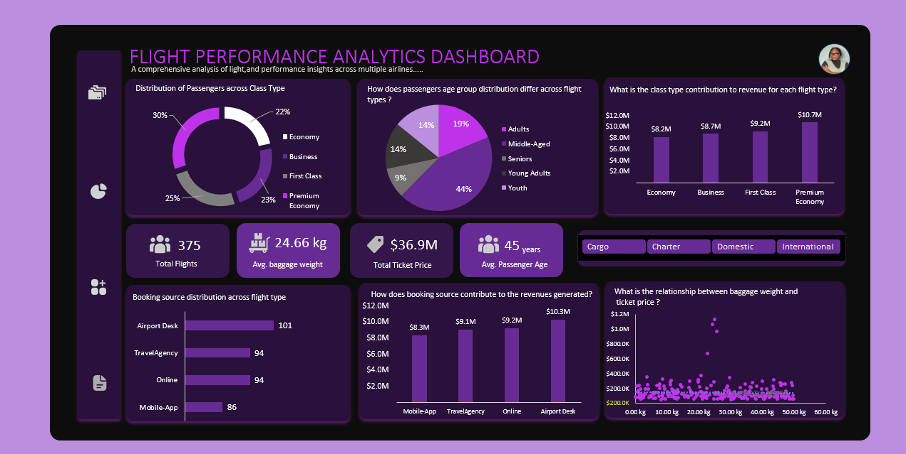

# flight-performance-analytics
# Flight Performance & Revenue Analytics Dashboard

---

## 1. Project Overview

This project presents a commercial performance and revenue analysis across 375 flight operations using Microsoft Excel and Power Query.

To deliver an interactive, app-like user experience, the workbook features an **Application-Style Navigation System**. It includes a central **Navigation Bar Landing Page** and a custom **Sidebar Menu** integrated across every worksheet, allowing users to jump seamlessly between raw data logs, pivot analysis engines, executive dashboards, and data dictionaries.

The analytical dashboard evaluates commercial flight yield across seat classes (*Premium Economy, First Class, Business, Economy*), booking sources (*Airport Desk, Travel Agency, Online, Mobile App*), passenger age demographics, and operational flight categories (*Cargo, Charter, Domestic, International*).

---

## 2. Business Problem

Commercial aviation leadership often evaluates performance using aggregate revenue totals. However, evaluating flight operations without segmenting by operational flight type (*Cargo, Charter, Domestic, International*) creates severe operational blind spots.

Without clear channel and seat-class segmentation, commercial teams risk misallocating marketing budgets toward underperforming booking platforms, overstaffing low-demand airport desks, or mispricing seat inventory. For instance, strong international ticket sales can mask declining digital mobile app bookings or inefficient seat allocation on domestic routes.

This analysis brings visibility to $36.9M in flight manifest revenue across 375 flights, identifying revenue drivers, passenger demographics, and booking channel inefficiencies to support yield management and channel strategies.

---

## 3. Dataset Description

The dataset comprises 375 operational flight records covering commercial, charter, and cargo flights. Each record captures seat class, destination region, booking source, flight duration, passenger demographics, flight manifest revenue, and checked baggage weight.

---

## 4. Business Questions

To evaluate commercial performance and yield efficiency, this analysis answers four key business questions:

### 1. Executive Performance & Yield
* What is the total gross revenue, flight volume, average passenger age, and average baggage weight across all operations?
* Which cabin seating class generates the highest gross revenue and passenger volume?

### 2. Operational Flight Type Cross-Segmentation
* How do total revenue, flight volume, and average baggage weight shift across Cargo, Charter, Domestic, and International flights?
* Does cabin class revenue contribution vary by flight category?

### 3. Booking Channel Efficiency
* Which booking channel (*Airport Desk, Travel Agency, Online, Mobile App*) drives the highest volume and ticket revenue?
* Are digital booking channels outperforming traditional physical airport desks?

### 4. Passenger Demographics & Operational Drivers
* Which age demographic represents the primary customer segment across flight types?
* Is there a direct statistical correlation between checked baggage weight and flight ticket pricing?

---

## 5. Tools
 **Microsoft Excel:** Served as the primary tool for data ingestion, statistical aggregation, custom UI development, and interactive dashboard creation.
- **Power Query:** Used for schema inspection, data type formatting, and field standardization.
* **PivotTables & PivotCharts:** Powered the multi-dimensional calculation engine to compute revenue breakdowns by flight type, seating class, age groups, and channel distributions.
* **Custom UI & Formatting:** Built shape-based navigation controls, integrated sidebar menus, dynamic slicers, KPI summary cards, and scatter plot visualizations.

---

## 6. Data Cleaning and Preparation

he raw dataset contained structural inconsistencies, non-numeric suffixes embedded within numerical fields, missing records, and unformatted currency strings. Data cleaning and preparation focused on four key remediation areas:

* **Numeric Field Sanitization:** Cleaned non-numeric text suffixes (`NGN`, `years`, `hours`, `kg`) embedded inside `TicketPrice`, `PassengerAge`, `FlightDuration`, and `BaggageWeight` to convert raw text into standard numeric values.
* **Data Type Standardization:** Reclassified cleaned fields into proper numeric data types (Currency, Whole Numbers, and Decimals) to enable mathematical aggregation in PivotTables.
* **Missing Value Remediation:** Resolved incomplete entries and blank records across pricing, age, duration, and baggage fields to maintain statistical integrity across baseline summary KPIs.
* **Demographic Feature Engineering:** Categorized raw passenger ages into five distinct demographic cohorts (*Youth, Young Adults, Adults, Middle-Aged, Seniors*) to support customer segmentation analysis.

---

## 7. Exploratory Data Analysis and Methodology

The analytical methodology followed a structured 3-phase workflow focused on user experience and business modeling:

| Phase | Phase Name | Focus & Key Deliverables |
|---|---|---|
| **Phase 1** | **Custom Workbook UI & Navigation Architecture** | • Built an application landing page (`NAVIGATION BAR`). • Integrated an active vertical sidebar menu across all sheets (`DATA`, `ANALYSIS`, `DASHBOARD`, `DATA DIC`). |
| **Phase 2** | **Pivot Engine Development** | • Built 6 core PivotTables on the `ANALYSIS` worksheet. • Computed aggregate baseline KPIs ($36.9M Sales, 375 Flights, 45 yrs Avg Age, 24.66 kg Avg Weight). • Segmented data across Class Type, Age Group, Booking Channel, and Baggage Distributions. |
| **Phase 3** | **Interactive Visual Dashboard** | • Built 5 dynamic charts (Doughnut, Pie, Stacked Bar, Column, Scatter Plot). • Connected interactive Flight Type slicers (*Cargo, Charter, Domestic, International*) to drive real-time dashboard filtering. |

---

## 8. Dashboard and Analysis Files

The complete workbook and visual assets are structured as follows:

* **Excel Workbook:** [`Flight_Performance_Analytics.xlsx`](./Flight_Performance_Analytics.xlsx) *(Contains navigation landing page, raw data, pivot engine, and main dashboard)*

* **Landing Page Image:** 

* **Main Dashboard Image:** 

### Dashboard Visual Architecture & Design Notes
* **Top Metric Bar:** 4 KPI summary cards tracking total flights (375), average baggage weight (24.66 kg), gross revenue ($36.9M), and average passenger age (45 years).
* **Flight Type Slicer Bar:** Top-right interactive slicers controlling `Cargo`, `Charter`, `Domestic`, and `International` views.
* **Demographic & Class Tier Block:** Visualizes passenger class distribution (Doughnut Chart) and age breakdown (Pie Chart).
* **Revenue & Channel Distribution Block:** Displays class revenue contributions (Bar Chart), booking source counts (Horizontal Bar Chart), channel revenue totals (Column Chart), and pricing-vs-baggage relationships (Scatter Plot).
* **Design Choice (Scatter Plot):** The scatter plot is intentionally unlinked from the Flight Type slicer to maintain a permanent 375-flight baseline reference for identifying high-value pricing outliers across the entire operational dataset.

---

## 9. Dashboard, Key Findings and Business Interpretation

### A. Overall Flight Performance Baseline

Across all 375 analyzed flights, the commercial baseline generated the following results:

| Overall Performance Metric | Result Value |
|---|---:|
| **Total Gross Revenue** | **$36,905,398.50 ($36.9M)** |
| **Total Flight Volume** | **375 Flights** |
| **Average Passenger Age** | **45 Years** |
| **Average Baggage Weight** | **24.66 kg** |
| **Top Seating Tier by Revenue** | **Premium Economy ($10.7M / 113 Flights)** |
| **Top Booking Channel by Revenue** | **Airport Desk ($10.3M / 101 Bookings)** |

---

### B. Segment Performance Across Flight Types (Slicer Analysis)

Filtering the dashboard dynamically across operational flight types reveals significant commercial differences:

| Performance Metric | Baseline (All) | Cargo Flights | Charter Flights | Domestic Flights | International Flights |
|---|---:|---:|---:|---:|---:|
| **Flight Volume** | 375 | 84 (22.4%) | 93 (24.8%) | 96 (25.6%) | **102 (27.2%)** |
| **Total Gross Revenue** | **$36.9M** | **$8.3M** | **$9.1M** | **$9.3M** | **$10.1M** |
| **Average Passenger Age** | 45 yrs | 43 yrs | 47 yrs | 47 yrs | 44 yrs |
| **Average Baggage Weight** | 24.66 kg | 23.66 kg | 24.20 kg | 25.10 kg | **25.48 kg** |
| **Top Revenue Class Tier** | Premium Economy ($10.7M) | Premium Economy ($3.0M) | First Class ($2.9M) | Premium Economy ($2.8M) | Economy ($2.8M) |
| **Top Booking Channel (Volume)** | Airport Desk (101) | TravelAgency (24) | TravelAgency (28) | Airport Desk (38) | Airport Desk (29) |
| **Top Booking Channel (Revenue)** | Airport Desk ($10.3M) | Mobile-App ($2.2M) | TravelAgency ($2.7M) | Airport Desk ($3.9M) | Online / Desk ($2.8M ea.) |

---

### C. Core Business Insights

#### 1. Premium Economy Leads Overall Yield; Economy Dominates International Revenue
* **Premium Economy** is the highest revenue-generating seating class overall, producing **$10.7M (29.0% of total revenue)** across 113 flights.
* On **International routes**, passenger demand shifts toward base fares: **Economy Class leads international revenue at $2.8M**, outperforming Business ($2.3M) and Premium Economy ($2.4M).
* **First Class** delivers high yield relative to volume on **Charter flights**, generating **$2.9M across 27 flights**.

#### 2. Booking Channel Performance (Airport Desk vs. Digital Mobile App)
* **Airport Desk** remains the single largest sales channel overall (**101 bookings / $10.3M revenue**). This is driven heavily by **Domestic flights**, where Airport Desks capture 38 of 96 bookings ($3.9M revenue).
* **Mobile App** trails overall (**86 bookings / $8.3M revenue**), generating a **$2.0M revenue deficit** compared to physical desks.
* On **Cargo flights**, **Mobile-App generates the highest revenue ($2.2M)** despite handling fewer total bookings than Travel Agencies, indicating higher average manifest value per transaction.

#### 3. Demographic Concentration
* **Middle-Aged passengers (46–60 years)** account for **44% of total volume (164 out of 375 flights)**, forming the core customer demographic across all flight categories.
* **Seniors (>60 years)** represent the smallest passenger segment at **9% (35 flights)**.

#### 4. Pricing vs. Baggage Weight Relationship (Outlier Analysis)
* Baseline ticket manifest prices cluster between **$200K and $400K** across checked baggage weights ranging from **0.00 kg to 60.00 kg**.
* **High-Value Outliers:** Select high-value flight bookings peak between **$600K and $1.2M** while carrying standard baggage weights (15 kg–25 kg), representing specialized group bookings or VIP charter manifests whose pricing operates independently of baggage allowances.

---

## 10. Business Recommendations

Based on these findings, commercial leadership should consider the following five actions:

1. **Expand Premium Economy Capacity on Domestic and Cargo Routes:** Premium Economy produces the highest overall revenue ($10.7M). Reconfiguring cabin layouts to increase Premium Economy capacity on Domestic routes can capture higher passenger yields without pricing out business travelers.
2. **Drive Digital Conversions on the Mobile App:** Mobile App revenue ($8.3M) trails Airport Desks ($10.3M) by $2.0M. Implementing mobile-exclusive booking incentives or digital check-in perks will shift routine domestic bookings to mobile channels, reducing airport desk operational overhead.
3. **Optimize Staffing at Domestic Airport Desks:** Domestic flights rely heavily on physical Airport Desks (38 out of 96 flights; $3.9M revenue). Ensure desk staffing aligns with peak domestic departure windows while driving long-term digital shift initiatives.
4. **Focus Marketing on the Middle-Aged Demographic:** With Middle-Aged travelers accounting for 44% of total flight volume (164 flights), marketing campaigns for premium seating tiers and loyalty programs should target professionals aged 46–60.
5. **Adjust International Economy Pricing and Baggage Add-Ons:** International travelers heavily favor Economy seating ($2.8M top revenue tier). Introducing tiered baggage add-on bundles for international economy passengers will capitalize on the higher average baggage weights observed on international routes (25.48 kg).

---

## Author and Contact

**Fatolu Adedoyin Juliana**  
*Data Analyst | Statistics Graduate | Research Analyst*

* **LinkedIn:** [Fatolu Adedoyin Juliana](https://www.linkedin.com/in/fatolu-adedoyin-juliana)
* **GitHub Profile:** [fajuliana-source](https://github.com/fajuliana-source)
* **Email:** fatoluadedoyin46@gmail.com
